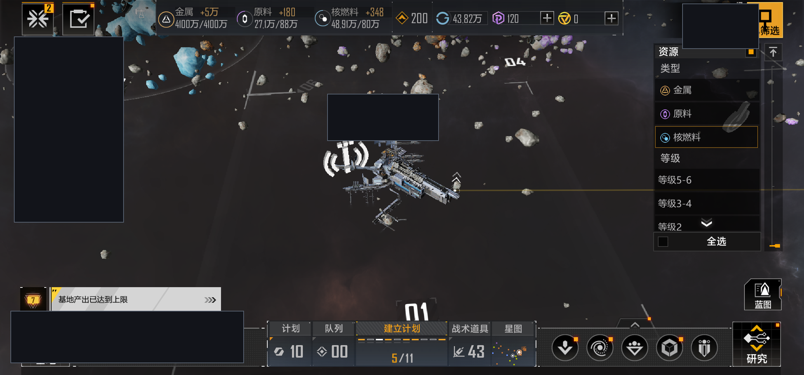
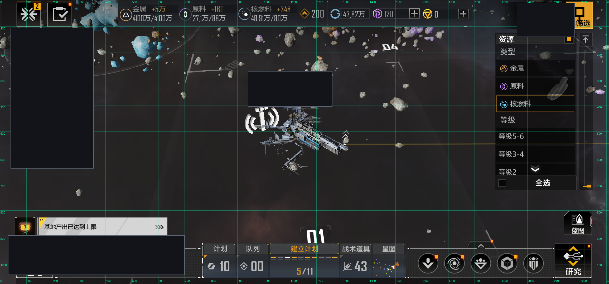

<div align="center">

# 🛰️ 星际猎人 · ADB 自动挂机助手

**原名《无尽的拉格朗日》，游戏改名后为《星际猎人》。一款基于 ADB + OCR 的安卓手游自动挂机工具，支持模拟器与真机双端。**

[](https://www.python.org/)
[](LICENSE)
[](https://www.microsoft.com/windows)
[](https://github.com/ZXCVBNM487/lglr-autoupgrade/releases/latest)

</div>

---

## 📌 功能简介

- **自动升级建筑 `autoup`**：周期性检测建造队列，队列有空位时自动补位升级；内置**掉线自愈**、**跨天自动日常**、**领取回执校验**，可长期无人值守挂机。
- **日常领取 `daily`**：任务面板一键领取（主线 / 委托 / 支线 / 赏金）+ 活动面板领取 + 邮件附件领取。
- **一体化 `all`**：`autoup` + `daily` 一键启动。
- **图形化测试仪 `tester`**：打包为 `星际猎人测试仪.exe`，可视化选择指令、实时日志与画面预览，适合不熟悉命令行的用户。
- **双端通用**：模拟器（MuMu 等）与真机（Android）均支持，所有坐标按设备分辨率自动等比缩放。

## 🖥 界面展示

**游戏内实测画面**（adb 截取，2310×1080，已对玩家昵称 / 联盟聊天 / 星区坐标脱敏）：



带 100px 坐标网格的校准图，用于核对各点击参数：



> 完整的点击坐标 / OCR 区域 / 判定阈值清单见 **[docs/点击坐标参数表.md](docs/点击坐标参数表.md)**，
> 含设计基准、`scale_box` 缩放规则、各界面参数分组、实测记录与待复核清单。

图形测试仪（`tester.py` / `星际猎人测试仪.exe`）提供：

- 顶部设备区：**一个合并下拉**列出所有在线设备（可选「自动选择第一个」或具体设备），
  下一行把所有在线设备紧凑排在一起显示（ID / 分辨率 / 型号），并有「当前设备」高亮标识；
- 「刷新扫描」重新枚举设备（离线 / 未授权只计数提示）；「截图所选」给选中设备截一张图，
  截图后在界面与日志里明确回报设备信息并更新右侧预览；
- 指令按钮：`check` / `status` / `shot` / `scan` / `icons` / `daily` / `autoup` / `all`；
- 右侧实时画面预览与运行日志；
- 底部状态栏（空闲 / 运行中 / 完成耗时 / 异常退出码）。

> 可下载的 exe 见 [Releases](https://github.com/ZXCVBNM487/lglr-autoupgrade/releases/latest)。

## 📱 设备支持

| 类型 | 说明 |
| --- | --- |
| 模拟器 | MuMu 等，需开启 ADB 调试（常见端口 `16384` / `7555`） |
| 真机 | Android 设备，开启「USB 调试」（开发者选项） |

识别方式遵循「少靠坐标、多靠 OCR 文字识别」原则，降低分辨率变化导致的误触。

**扫描与选择**：启动后自动扫描本机 ADB 设备，**不再区分真机 / 模拟器**（序列号特征不可靠），
所有在线设备合并到一个下拉并紧凑列在一起；离线、未授权设备只计数提示、不参与选择。
选择「自动」或具体设备后，界面高亮「当前设备」并写回 `device.serial`；点「截图所选」
即对这台设备截图，右侧预览同步更新，日志回报
「设备 ID ｜ 状态 ｜ 分辨率 ｜ 型号 ｜ 截图大小 ｜ 文件」。

配置里只有 `device.serial`：留空 = 自动挑第一个在线通道；填序列号则只连这一台，
**该设备不在线时脚本会明确报错退出，绝不误连其它设备**。MuMu 常同时开出多个 adb
通道指向同一台机子，会一起出现在合并列表里，选最快的那个即可。

## ⚙️ 环境要求

- Windows 系统
- Python 3.12+（开发与测试使用 3.14）
- [ADB](https://developer.android.com/tools/adb)（Android Debug Bridge）
- 已授权调试的模拟器或真机

## 📥 安装

### 方式一：下载 exe（推荐新手）

前往 [Releases](https://github.com/ZXCVBNM487/lglr-autoupgrade/releases/latest) 下载**最新版（Latest）**的发布压缩包（文件名形如 `lglr-tester-vX.Y.Z.zip`），解压后双击其中的 `星际猎人测试仪.exe` 即可使用，无需安装 Python。

### 方式二：源码运行

```bash
git clone https://github.com/ZXCVBNM487/lglr-autoupgrade.git
cd lglr-autoupgrade
pip install -r requirements.txt

# 图形界面
python tester.py

# 或命令行（不带参数即打印全部子命令）
python lagrange_upgrade.py
```

## 🚀 命令行使用

`lagrange_upgrade.py` 支持以下指令：

| 指令 | 说明 |
| --- | --- |
| `all` | 一体化：日常领取 → 自动升级循环（**挂机首选**） |
| `autoup` | 自动升级建筑（循环挂机，队列驱动） |
| `daily` | 日常领取（任务 + 活动 + 邮件） |
| `check` | 连接与运行环境自检（GUI 启动自检用） |
| `status` | 一屏状态汇总（屏幕 / 前台 / 队列 / 资源），只读 |
| `shot` / `scan` | 截图 / 全屏 OCR 文字坐标标注 |
| `icons` | 纯图标入口校准（检测注册表，生成 `icons_标注.png` / `icons_活动区.png`） |
| `adbs` | 全盘扫描所有 adb.exe，逐个测版本 / 可用性 / 在线设备（约 25 秒，结果存 `logs/adb_scan.json`） |
| `times` / `mark` | 列出倒计时 / 生成界面标注图 |
| `tap X Y` | 测试点击某坐标 |
| `genconfig` | 打印 `config.json` 路径 |

不带参数运行会打印上面这份用法说明。

**配置**：复制 `config.example.json` 为 `config.json`，按需填写：

- `device.serial`：留空自动挑第一个在线通道；填序列号则只连指定设备（离线时报错退出，不误连）
- `performance.eta_calibrate_every`：静默等待中重读真实倒计时的间隔（秒，默认 3600 = 1小时，0=关闭）。越低越准但越费电
- `adb_path`：留空则自动寻找模拟器自带 adb（雷电 / MuMu / 夜神等）；也可填完整路径或 `adb` 走系统 `PATH`。**2026-11-24 全盘扫出本机 14 个 adb.exe（全部可用、全部能连真机），已全部补进 `adb_locator.py` 静态表**：含你指定的 MuMu `nx_device/12.0/shell/adb.exe` 与 `nx_main/adb.exe`（v36.0.0）、`E:\AndroidBuild\platform-tools-latest-windows\platform-tools\adb.exe`（v37.0.1）及 E/C 盘多个 platform-tools。GUI 点「⑥ 扫描全部 ADB」或命令行 `adbs` 可随时重新扫描、逐个测版本/可用性/在线状态。
- `au_target_building`：一键升级循环优先升级的目标建筑名（OCR 模糊匹配，留空则升可见第一个可升设施）
- `au_locked_buildings`：绝不自动升级的建筑名单（模糊匹配，用于保护保级 / 特殊用途设施）；留空 `[]` 表示不锁定
- 通知方式（QQ OneBot / QQ 官方机器人 / 邮件，默认全关，按需开启）

> 真实的 `config.json` **不会被提交到仓库**，请妥善保管其中的凭据。
>
> 需要校准点击坐标 / OCR 区域时，先跑 `python lagrange_upgrade.py scan` 画框标注，
> 对照 [点击坐标参数表](docs/点击坐标参数表.md) 调整区域常量（所有坐标都按 2310×1080
> 设计基准记录，由 `scale_box` 自动换算到实际分辨率）。

### 🧩 速本方案（多套升级配置保存与切换）

`profiles.json` 与 `config.json` 同目录，保存多套固定的升级配置；测试仪顶部的「速本方案」下拉可一键切换，选择后自动写回 `active`。

```json
{
  "active": "速本",
  "profiles": {
    "速本": {
      "note": "冲本路线",
      "strict": false,
      "locked_buildings": [],
      "build_order": [
        {"name": "平台指挥中心", "target_level": 8},
        {"name": "资源港口", "target_level": 10}
      ]
    }
  }
}
```

| 字段 | 说明 |
| --- | --- |
| `build_order` | **有序清单，越靠前越优先**；`autoup` 在底部队列条可见的建筑里按此顺序挑补位目标 |
| `target_level` | **目标等级**；建筑详情里读到当前等级 ≥ 目标就自动跳过、不再点升级。填 `0` = 不限等级 |
| `locked_buildings` | 该方案额外锁定的建筑，与 `config.json` 的 `au_locked_buildings` 合并生效 |
| `strict` | `true` = 清单未命中就**不补位**（严格按方案）；`false` = 回退原有默认补位逻辑（默认，兼容性好） |
| `active` | 填 `""` 或在下拉里选「（不启用方案）」= 完全走原有逻辑 |

模板见 `profiles.example.json`；`profiles.json` 不存在时程序会自动生成示例。测试仪里的「编辑方案」按钮可直接打开该文件改清单，「刷新」重新载入方案列表。

> 等级识别读的是建筑详情面板里的 OCR 文本（`Lv.7` / `等级 7` / `7级` 这类写法）。
> 若实机文字格式不同，方案仍会按清单顺序补位，但「到级自动跳过」不会生效——
> 读不到等级时一律**不跳过**（照常升级），宁可多升也不漏升。

### 🌡 性能档位（长时间挂机发热 / CPU 占用）

挂机时 CPU 温度偏高，实测根因是 **2310×1080 全屏 OCR 一次约 6~9 秒**，ONNXRuntime 默认吃满所有核心、推理间隙 OpenMP 线程还会自旋忙等；一旦界面读不懂，旧逻辑会约 2.5 秒一轮不停「截图 + 全屏 OCR」。现在默认启用**省电档**：

| 档位 | OCR 线程 | 每轮间歇 | 卡住退避上限 | 界面日志轮询 |
| --- | --- | --- | --- | --- |
| 省电 `eco`（默认，推荐） | 2 | 10s | 90s | 500ms |
| 均衡 `balanced` | 4 | 5s | 45s | 300ms |
| 原速 `turbo`（排障用，发热最高） | 不限 | 不额外等待 | 不额外等待 | 120ms |

优化手段：① 加载 OCR 前设置 `OMP_NUM_THREADS` / `OMP_WAIT_POLICY=PASSIVE`，关掉多核满载与自旋等待；② 主循环每轮结束后固定间歇（含所有 `continue` 分支），连续无进展按 1.7 倍指数退避到上限，队列满载 / 成功升级 / 长睡后自动重置；③ 亮屏与前台健康检查节流（WAKEUP 保活仍每轮发送，避免手机自动息屏截到黑屏）；④ 测试仪日志轮询按档位降频。

切换方式：测试仪顶部「性能档位」下拉，或直接改 `config.json`：

```json
"performance": { "mode": "eco" }
```

也可以单独覆盖数值，例如 `{"mode": "eco", "ocr_threads": 2, "loop_min_interval": 15, "backoff_max": 120, "gui_poll_ms": 500}`；非法值自动回退默认。**档位在挂机进程启动时读取，切换后需重启挂机才生效**（速本方案则支持运行中切换）。

> 只改「多久检查一次」，不改升级判定、点击坐标与护栏逻辑；队列满载等待倒计时期间依旧零占用。
> 若挂的是 MuMu 等模拟器，游戏本身渲染也会发热，脚本优化降低的是 PC 端 OCR / adb 的额外负载。

## 🗂 项目结构

```
lglr-autoupgrade/
├── lagrange_upgrade.py     # 核心：autoup / daily / all / check / status / scan ...
├── tester.py               # 图形化测试仪（PyInstaller 打包为 exe）
├── tester.spec             # 打包配置（唯一有效的一条打包链）
├── build_exe.bat           # 一键打包脚本
├── 3_停止全部.bat           # 停止挂机并释放 ADB（GUI 里也有停止按钮）
├── adb_locator.py          # ADB 智能定位（被核心引用）
├── qq_official.py          # QQ 官方机器人推送（默认关闭，被核心引用）
├── config.example.json     # 配置模板（脱敏，不含任何凭据）
├── profiles.example.json   # 速本方案模板
├── requirements.txt        # 依赖清单
├── refs/                   # 界面识别用的参考图标模板
├── tests/                  # 纯逻辑单元测试（76 项，无需设备 / OCR）
│   └── test_lagrange.py
├── docs/                   # 开发笔记 + 点击坐标参数表 + 脱敏界面截图
├── LICENSE                 # MIT 协议
├── CONTRIBUTING.md         # 贡献指南
└── README.md
```

> `config.json` / `profiles.json` 是本地运行态文件（含设备信息与个人打法），不入库；
> `dist/` 里的 exe 由 `build_exe.bat` 生成，也不入库。`docs/` 下的修复报告是历史记录，
> 其中提到的旧 exe 名与旧路径已不再适用。

### 🎯 纯图标入口（无文字，OCR 找不到）

活动、邮件、任务清单、关闭 X 等入口**只有图标、没有文字**，靠 OCR 找文字或写死坐标都会失配。
实测（同一图标在不同设备会漂移）：2310×1080 历史星图里任务剪贴板在 `(297,55)`、
邮件 `(467,862)`；1600×900 实机上变成 `(150,46)` / `(292,719)`，换算回设计基准是
`(217,55)` / `(422,863)`，而旧硬编码写的是 `(147,30)` / `(465,860)`。
模板多尺度匹配在两种分辨率下都稳定命中（分数 0.95/1.00 与 0.85/0.76），
所以入口统一走**图标模板（限定搜索区 + 多尺度）→ 坐标兜底 → 点击后 OCR 验证**。

注册表是 `lagrange_upgrade.py` 的 `ICON_ONLY_ENTRIES`，模板放在 `refs/`：

| 入口 ID | 名称 | 模板 | 兜底坐标 (2310×1080) | 状态 |
| --- | --- | --- | --- | --- |
| `task_clipboard` | 活动面板（左上剪贴板，旧名「任务清单」已废弃） | `icon_task.png` | (217,55) | 实机模板命中 0.85 |
| `mail_envelope` | 邮件（左下信封） | `icon_mail.png` | (422,863) | 实机模板命中 0.76 |
| `activity_entry` | 活动入口（左上同一个剪贴板图标） | `icon_task.png` | (217,55) | **2026-11-22 实机确认并启用** |
| `close_x` | 面板关闭 X | `close_x.png` | (2195,70) | 实机模板命中 0.815 |
| `task_close` | 任务面板返回星图（右上展开/收起键） | 无（旧门形模板会误命中，已停用） | (2194,54) | 实机 `(1520,45)`@1600×900 可退回星图 |
| `live_widget` | 右上直播挂件 | 无 | — | **禁点**（点它会死循环） |
| `exit_cancel` | 退出确认框取消 | 无 | (1495,700) | 安全护栏 |

**活动入口实证**（2026-11-22，1600×900 实机）：星图点左上 `(150,46)` 打开的就是活动面板
（页签「活动 / 探险协议 / 永恒战场」+ 月度登录 / 活跃挑战领奖等侧栏条目），
之前一直没找到活动图标，是因为这个入口被命名成了「任务清单」。
因此 `activity_entry` 复用同一模板与坐标，`_daily_enter_activity` 点击后会用
「探险协议」验证，不再需要人工填坐标。旧 `(320,60)` 是等级图标 / 公告条，**永久废弃**。

**校准**（需模拟器/真机在线）：

```bash
python lagrange_upgrade.py icons
```

它会逐项输出定位方式与匹配分数，并生成 `icons_标注.png`
（绿点=模板命中／黄点=坐标兜底／红叉=禁点／蓝框=搜索区）、
`icons_活动区.png`（顶部活动区放大 2 倍）和 `icons_快捷条.png`（左下纯图标排放大 2 倍）。
找到活动图标后，把中心坐标换算成
2310×1080 设计基准，写进 `config.json`：

```json
"icon_entries": {
  "activity_entry": {
    "fallback": [1234, 56],
    "template": "icon_activity.png"
  }
}
```

`template` 可选（裁好的图标放 `refs/`）；也可只填 `fallback`。`icon_entries` 能覆盖注册表
任意字段（`search` / `threshold` / `scales` / `fallback`），坐标运行时都由 `scale_box`
按实际分辨率换算，不需要改代码。当前 7 个入口均已内置模板或坐标，只有 `live_widget` 是禁点护栏。

**网络 ADB 掉线自动重连**：WiFi / 桥接模拟器是 `IP:端口` 形式，通道掉线后 adb server 里
就没这台设备了，而旧扫描只连 `127.0.0.1:<端口>`，会一直报"没有检测到模拟器"。
现在 `Adb` 启动时把 `config.device.serial` 和 `state.json` 的 `last_device` 记为重连候选，
`scan_and_connect()` 优先重连这些网络地址（仍在 6 秒预算内），成功后再写回 `last_device`。
实机验证：手动 `adb disconnect` 后跑 `check`，8.1 秒自动连回、退出码 0。

## ⚠️ 注意事项

- 这是 Unity 游戏，系统返回键会弹"确定要退出游戏"，脚本已内置护栏，请勿手动按返回。
- 基地建设页右上角直播挂件不是"一键升级"，脚本已规避误点。
- 需游戏处于前台、屏幕常亮；建议先连好设备/模拟器再启动。
- 同一台设备**只允许一个实例驱动**（autoup / daily / all 已加单实例锁）：重复启动会被拒绝，从根上杜绝两个脚本抢占 ADB 信道互相干扰。停止运行请点 GUI 的停止，或**直接关闭窗口**（会一并杀掉挂机子进程树）；双击根目录的 `3_停止全部.bat` 可兜底清理 python / adb 残留。**GUI「控制」区新增「☠ 全部终止（清残留进程+锁）」按钮（2026-11-24）**：一键清掉所有残留的测试仪 exe（含孤儿进程）、跑脚本的 python 进程、adb.exe 和 `.run_lock`（根 + dist 两处），并且**严格防误杀**（2026-11-24 收窄）：只杀可执行文件/命令行位于本项目目录内的进程，别的项目同名脚本一概不碰；adb 只对本项目配置的那个做优雅 `kill-server`，**不会杀掉你 MuMu 模拟器或其它工具的 adb**。遇到后台残留时点它即可，不用开任务管理器。
- 挂机子进程会监测测试仪父进程：即使 GUI 被强制结束、来不及点停止，它也会在约 2 秒内自动退出，不会留在后台继续占着设备。
- 所有坐标以 **2310×1080 为设计基准** 并经 `scale_box` 等比缩放；修改前请看 [点击坐标参数表](docs/点击坐标参数表.md)，尤其注意右上角直播挂件（禁点）与旧活动入口 `(320,60)`（已废弃）这两处。
- **autoup 定位规则（2026-11-22 实机修复）**：建筑名只在底部队列条区域 `_AU_QUEUE_BAR_BOX` 内找，`返回地图 / 基地建设 / 行政 / 对接信息 / 视野收集 / 环绕视角` 等导航词一律排除；判断"已在基地页"必须同时看到「基地建设」和「返回地图」（星图中的提示文字「基地建设-舰队编组」不算）；导航回基地只在底部 y>0.78h 区找「基地」。队列是否满载除了两条倒计时，还认底部状态 `2/2`。**页面未识别时绝不按系统返回键**（会弹退出确认框并无限循环），只等待退避。
- **升级循环只走「一键升级」（2026-11-23 定稿）**：只点基地建设页游戏内「一键升级」面板里的橙色「升级」按钮（入口设计 `(1946,67)` / 实机 `(1348,56)`@1600×900），不进建筑详情、不用普通升级补位。
- **稳定性修复（2026-11-24 12:40 代码整理 + 实机验证）**：① 建筑详情面板是**右侧抽屉**，关闭要点**左侧空白**（旧点 60% 宽落在面板内，导致"关闭→仍在"死循环卡住升级）；② `_au_queue_times` 统一过滤低分 OCR，防幻影倒计时让脚本静默空等数小时；③ 活动弹窗 X 在截图失败（img=None）时不再抛异常崩溃，改用校准兜底坐标；④ state.json 改**原子写**（临时文件+os.replace），GUI 读取不闪断；⑤ 写入 state 的条数与 ETA 数量自洽；⑥ `_publish_upgrade_etas` 逐条容错，单条脏数据不丢全部。**ADB 端到端实测通过**：跨天日常→1个升级补位→点升级→2个升级静默等待，state 写入两条正确 ETA，无空转/无反复点。全量单测 174 项通过。
- **底部实时升级倒计时条（2026-11-23 19:45）**：GUI 窗口最底部状态栏上方有一条「升级倒计时」条，并排显示两条倒计时 + 建筑名，始终可见。数据来自 `state.json.upgrade_etas`（升级循环每轮用 `_publish_upgrade_etas()` 写入秒数 / 建筑名 / 写入时刻），GUI 每秒读取并按 `写入时刻 + 秒数` 本地逐秒递减——脚本静默等待不写文件时也会自己走时，刷新后重置基准；剩余 ≤5 分钟转黄色、有升级点亮绿点、无数据显示 `--:--:--`。CLI 挂机也会写入，下次打开 GUI 即可看到当前进度。**左右顺序按 x 坐标（列）配对**（`_au_queue_pairs()`，2026-11-24 修"左右搞反"）——倒计时与正上方最近的建筑名配对，不依赖 OCR 返回顺序，名字漏读则留空不错配。**每小时校准一次（2026-11-24）**：静默等待期间每 3600 秒重读一次真实倒计时并写回 state.json 重置基准，避免 GUI 本地递减长时间漂移；校准只读不点击、不提前结束等待（队列空除外）。频率由 `performance.eta_calibrate_every` 控制（秒，默认 3600，设 0 关闭）；**GUI 里「检测间隔」输入框可直接填分钟（默认60，0=关闭）并点保存**，比改配置文件方便，改动需重启挂机生效。**一键升级点完也立即重读一遍**（`_au_handle_panel()` 点升级后调 `_au_recalibrate_etas()`，2026-11-24）——收起回**基地 3D 全景主界面**（底部有「返回地图/基地建设 2/2/行政」和两条队列倒计时的那个界面）后，用 ADB 截图立刻重读真实队列写回 state，GUI 马上显示新队列，不等下一轮。OCR 对倒计时尾缀多读一位（如 `00:27:093`）已容错。
- **【第一时间数升级数量】（2026-11-23 19:26 修死循环）**：循环一开始先数"几个建筑在升级"（`_au_upgrade_state()`，读底部 `2/2 / 1/2 / 0/2` + 倒计时）：**2 个在升级** → 看最近到期还有多久，不管它、静默等待（+20 秒）；**1 个在升级** → 看这一个还有多久，去点一次一键升级补位；**0 个** → 去点一次一键升级。关键修复：若停在建筑列表视图（底部是建筑卡片、读不到队列条），先收起回 3D 全景视图重读，绝不把"读不到"当成空位去反复点升级；点升级后面板没开也立即回全景重新计数，**移除原"30 秒复查"裸空转**（那正是死循环根因）。90 秒冷却仍保留防重复点。147 项单测通过，实机验证 2/2 满载时正确静默等待、画面无面板误开。
- **先点进基地建设再点一键升级（2026-11-23 15:10 最终修复）**：基地建设有两种视图，右上同一坐标含义不同 —— 3D 全景视图 `(1345,50)` 是**分享按钮**（盲点会弹分享面板），建筑列表视图 `(1345,55)` 才是「一键升级」文字按钮；且只有 3D 全景视图底部才显示两条队列倒计时。因此脚本：① OCR 明确读到「一键升级」文字才点；② 读不到且 `_au_base_list_view()` 判定是 3D 全景视图时，先点底部「基地建设」标签（设计 `(1156,988)` / 实机 `(801,823)`）展开列表视图、等 5 秒转场；③ 点完升级后点右上折叠图标（设计 `(2180,66)` / 实机 `(1510,55)`）收起回全景视图读倒计时，形成闭环、不反复点。另加分享面板识别（小红书等）+ 右上 X（设计 `(2194,54)`）关闭兜底。资源判断交给游戏：面板「消耗资源」是「本次消耗 / 当前拥有」，旧预判反着理解会误判不足并长等 3 小时、从不去点升级按钮，已删除该预判。详见 [全功能测试报告](docs/全功能测试报告_20261123.md) 第七节。
- **活动弹窗自动关闭（2026-11-23 定稿）**：整屏遮罩 + 中央大标题 + 下方「前往查看」+ 右上 X 的活动弹窗会挡住基地页和日常流程。按用户定稿**不识别主题**——标题每次都不同（暗流汹涌 / 危机-防御劫掠者战役 / 反攻时机 / 资产技术成果展销…），只认弹窗自身的「前往查看」按钮，出现即判定并点右上 X 关闭（`find_close_x()` 模板优先，兜底设计 `(2195,70)` / 实机 `(1520,58)`），**绝不点「前往查看」**。ADB 实机验证 X 坐标 `(1522~1523,57~66)` / 兜底 `(1520,58)` 均能稳定关闭。`cmd_autoup` 主循环与 `_daily_ensure_starmap()` 均已接入。
- **全量点位校准与复核（2026-11-23）**：历史原始截图 / 红框标注在 `点位校准_20261122_全量/`；复核后的实机重跑截图 / 标注 / JSON 在 `点位校准_20261123_复核/`，复核结论以新目录为准。`points.json` 是代码可读取的点位配置：`坐标` 为校准设备实机像素（1600×900），`设计坐标` 为 2310×1080 基准，二者必须能互相换算（`python lagrange_upgrade.py points` 会逐项自检）。**双入口已定稿**：左上 `#13` 星形徽记 `(53,43)`@1600×900 = 任务面板（`task_panel_entry` / `refs/icon_quest.png`），左上 `#14` 剪贴板 `(150,46)` = 活动面板（`activity_entry`）。`point_double_check()` 执行「设计坐标 → scale_box → ADB 点击 → 等转场 → OCR 校验目标文字」双重保险；转场读到 0 文字不算失败、点击无变化记异常点、导航词永不作为建筑目标。右上 `expand_view` 只在**任务面板**内出现，星图右上 `(1523,57)` 是「已筛选」过滤器，不是展开键。

## ⚠️ 免责声明

> 本项目仅供**学习与研究 ADB / OCR / UI 自动化技术**之用。
>
> 使用自动化工具操作游戏可能违反游戏运营方的《用户协议》，由此产生的账号封禁、数据丢失等风险**由使用者自行承担**。请勿用于商业用途、批量养号或破坏游戏公平性的行为。
>
> 项目作者不对任何因使用本工具导致的后果负责。

## 🤝 贡献

欢迎 Issue 与 Pull Request！提交前请阅读 [CONTRIBUTING.md](CONTRIBUTING.md)。

- **反馈问题**：请在 Issue 中附上运行日志与设备 / 模拟器信息；
- **提交代码**：保持核心逻辑（`lagrange_upgrade.py`）风格一致，新增功能请补充单元测试。

## 📄 开源协议

本项目基于 [MIT License](LICENSE) 开源。

## 🙏 致谢

- [RapidOCR](https://github.com/RapidAI/RapidOCR) —— 游戏内文字识别（OCR）
- [Android Debug Bridge (ADB)](https://developer.android.com/tools/adb) —— 设备控制
- [March7thAssistant（三月七小助手）](https://github.com/moesnow/March7thAssistant) —— 同类**游戏自动化**项目的思路参考
